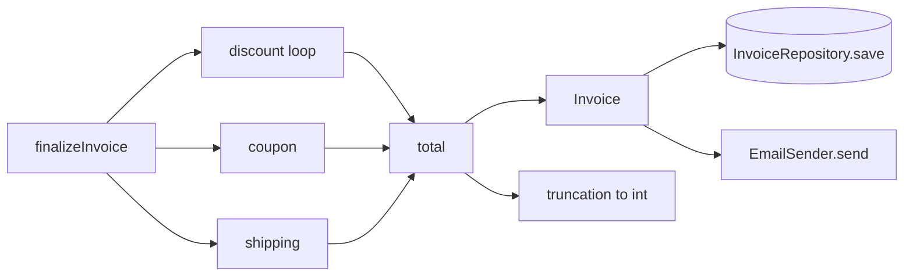

# The 20% of Legacy Code That Unlocks the Other 80%

> “To me, legacy code is simply code without tests.”
> — Michael C. Feathers, *Preface*

You inherit an eight-year-old invoice service. It works. It has customers. Nobody wants to touch it.
The last person who did is no longer with the company, and the phrase “we think it still works” is
doing a lot of work in the stand-up.

This is not a summary of *Working Effectively with Legacy Code*. It is the **minimum viable subset**:
the twelve ideas that, in practice, unlock almost every other technique in the book. The rest —
link seams, template redefinition, procedural C, monster-method deep cuts — are real, but they are
specializations. Learn these twelve first and you can handle the ordinary Tuesday afternoon.

Everything is demonstrated against one running Java 21 codebase. The techniques predate records and
sealed interfaces; modern Java just makes the seams cheaper to build.

> [!abstract] The deal
> - **One running example** — an untestable `InvoiceService`, evolved step by step.
> - **Twelve concepts**, chosen for leverage rather than completeness.
> - **Java 21 throughout** — records, sealed interfaces, pattern matching, sequenced collections,
>   `java.time.Clock`.
> - **The 80% you can skip** is listed at the end, so you know what you are skipping.

> [!info] Setup
> Java 21, JUnit 5. Imports are omitted from snippets; assume `java.time.*`, `java.util.*`,
> `java.math.*`, and `static org.junit.jupiter.api.Assertions.*`.

---

## The Pareto map

These twelve are the highest-leverage concepts in the book's idea graph — the ones with the most
connections to everything else. If you can do these, the long tail becomes look-up work.

| # | Concept | Type | The question it answers | Book |
|---|---|---|---|---|
| 1 | **Cover and Modify** | technique | Can I change this safely? | Ch. 2 |
| 2 | **Seam** | concept | Where can I change behavior without editing here? | Ch. 4 |
| 3 | **Sensing, separation, fakes** | concept + technique | Why and how do I break this dependency? | Ch. 3 |
| 4 | **Characterization tests** | technique | What does this code actually do? | Ch. 13 |
| 5 | **Test covering / change points** | technique | What exactly should I pin? | Ch. 2, 11 |
| 6 | **Effect sketch → interception → pinch point** | concept + technique | Where should the test live? | Ch. 11–12 |
| 7 | **Sprout Method / Class, Wrap Method** | technique | How do I change code I cannot test? | Ch. 6 |
| 8 | **Extract Interface / Parameterize Constructor / Subclass and Override** | technique | How do I get this class under test? | Ch. 9, 25 |
| 9 | **Introduce Static Setter / Encapsulate Global References** | technique | What about singletons and globals? | Ch. 9, 25 |
| 10 | **Extract Method / Extract Class / responsibilities** | technique | How do I leave it better? | Ch. 20 |
| 11 | **Single-Goal Editing / Preserve Signatures / Lean on the Compiler** | technique | How do I avoid breaking it while refactoring? | Ch. 23 |
| 12 | **Legacy TDD / programming by difference** | technique | How do I add a feature safely? | Ch. 8 |

That is 12 of roughly 60 named techniques in the book. The selection is not arbitrary: in this
workspace's idea graph, the highest-centrality methods and concepts are Extract Interface, Extract
Method, Subclass and Override, Characterization tests, Seam, Pinch points, Effect sketch, and the
dependency-breaking catalog. These are the nodes that connect to the most other ideas — the ones that
show up in almost every real change. The long tail is real, but it is specialized.

> [!tip] How to read this
> Each section has the same shape: **context → the move → Java 21 demo → what to notice**.
> The code is cumulative. By the end, `InvoiceService` is testable, characterized, and smaller —
> without ever being rewritten from scratch.

---

## 0. The patient: an untestable invoice service

The domain is modern Java 21; the service is not.

> [!example]- Domain model (records)
> ```java
> package legacy.invoice;
>
> import java.time.LocalDate;
> import java.util.List;
>
> public record Product(String sku, String category, int unitPriceCents) {}
>
> public record OrderLine(Product product, int quantity) {}
>
> public record Order(String id, List<OrderLine> lines, String coupon) {
>     public Order {
>         lines = List.copyOf(lines);
>     }
> }
>
> public record Customer(String id, String email, boolean premium) {}
>
> public record Invoice(String customerId, int totalCents, LocalDate issuedOn) {}
> ```

> [!example]- The concrete adapters (the ones that make tests hurt)
> ```java
> public final class JdbcInvoiceRepository {
>     public JdbcInvoiceRepository(String url) { /* connect to the database */ }
>     public void save(Invoice invoice) { /* INSERT INTO invoices ... */ }
> }
>
> public final class SmtpEmailSender {
>     public SmtpEmailSender(String host, int port) { /* connect to SMTP */ }
>     public void send(String to, String subject, String body) { /* send */ }
> }
> ```

The legacy service:

```java
package legacy.invoice;

import java.time.LocalDate;

public class InvoiceService {

    private final JdbcInvoiceRepository repository =
            new JdbcInvoiceRepository(System.getenv("DB_URL"));

    private final SmtpEmailSender emailSender =
            new SmtpEmailSender("smtp.internal", 25);

    public Invoice finalizeInvoice(Order order, Customer customer) {
        double total = 0;
        for (var line : order.lines()) {
            double price = line.product().unitPriceCents() * line.quantity();
            if (customer.premium()) price *= 0.95;
            if ("BOOK".equals(line.product().category())) price *= 0.90;
            total += price;
        }
        if ("SAVE10".equals(order.coupon())) total *= 0.90;
        if (total > 100_000) total += 2_500;

        var invoice = new Invoice(customer.id(), (int) total, LocalDate.now());

        repository.save(invoice);
        emailSender.send(customer.email(), "Invoice " + order.id(), invoice.toString());
        return invoice;
    }
}
```

Read it as three separate problems wearing one method:

1. **Hidden construction** — constructing the service connects to a database and an SMTP server.
2. **Hidden time** — `LocalDate.now()` makes the result depend on the wall clock.
3. **Hidden policy** — discount order, shipping threshold, and a silent `double` → `int` truncation
   are all mixed into one loop.

Everything that follows removes one of those problems.

---

## 1. Cover and Modify — technique — “Can I change this safely?”

> [!info] Context
> There are only two strategies for changing code. **Edit and Pray**: plan carefully, poke nervously,
> hope. **Cover and Modify**: put a safety net of tests around the change, then move quickly because
> the net will catch you. The book's argument is economic: tests around change usually pay for
> themselves, because debugging and late defects cost more than the tests.

The first attempt to “just add a test” exposes the real problem:

```java
@Test
void constructsTheService() {
    var service = new InvoiceService(); // compiles, then connects to the DB and SMTP
}
```

The constructor runs before any assertion. It opens a database connection and an SMTP connection; in
CI, that is usually where the test dies. This is the normal starting point. The mistake is to
conclude “this code is untestable” and go back to Edit and Pray. The correct conclusion is narrower:

> The class is untestable **because it creates its dependencies itself**.

That is a seam problem, not a character flaw.

> [!warning] Trap
> “I’ll write tests after the change” is Edit and Pray with extra steps. The tests you write
> afterwards encode the behavior you just shipped — including the bug.

**What to notice:** Cover and Modify is not “test everything”. It is “cover the behavior this change
puts at risk, before the change”. The rest of the article is the machinery for getting that cover in
place when the code fights back.

---

## 2. Seam — concept — “Where can I change behavior without editing here?”

> [!quote]
> “A seam is a place where you can alter behavior in your program without editing in that place.”
> — *Working Effectively with Legacy Code*, Ch. 4

A seam has two parts:

- the **seam** itself — the place where behavior can differ;
- the **enabling point** — the place where you choose which behavior applies.

In Java, the cleanest seam is often a constructor parameter. `java.time.Clock` is a seam the JDK
already gives you: production uses the system clock, tests use a fixed instant.

```java
public final class InvoiceIssuer {

    private final Clock clock;

    public InvoiceIssuer(Clock clock) {
        this.clock = clock;
    }

    public Invoice issue(Customer customer, int totalCents) {
        return new Invoice(customer.id(), totalCents, LocalDate.now(clock));
    }
}
```

```java
@Test
void issuesWithAFixedDate() {
    var clock = Clock.fixed(Instant.parse("2026-01-15T10:00:00Z"), ZoneOffset.UTC);
    var issuer = new InvoiceIssuer(clock);

    var invoice = issuer.issue(new Customer("C-42", "ada@example.com", true), 23_087);

    assertEquals(LocalDate.of(2026, 1, 15), invoice.issuedOn());
}
```

Now apply the same move to the legacy service:

```java
public class InvoiceService {

    private final Clock clock;
    private final JdbcInvoiceRepository repository = /* ... */;
    private final SmtpEmailSender emailSender = /* ... */;

    public InvoiceService(Clock clock) {
        this.clock = clock;
    }

    public Invoice finalizeInvoice(Order order, Customer customer) {
        // ... unchanged ...
        var invoice = new Invoice(customer.id(), (int) total, LocalDate.now(clock));
        // ... unchanged ...
    }
}
```

The constructor is the **enabling point**. The `LocalDate.now(clock)` call is the **seam**. No
production branch, no `if (testing)`, no system property.

> [!tip] Java 21 note
> `Clock`, `Supplier<T>`, `Function<K,V>`, and small SAM interfaces are seams you can often use
> without inventing a new abstraction. Prefer a domain-named interface when the seam carries meaning
> (`TaxRateProvider`), and a JDK type when it is genuinely generic (`Clock`).

**What to notice:** a seam is not a mock. It is a decision point. The test decides the behavior at the
enabling point; the production code stays clean.

---

## 3. Sensing, separation, and fakes — concept + technique — “Why and how do I break this dependency?”

> [!info] Context
> The book gives exactly two reasons to break a dependency:
> - **Sensing** — you need to observe a value or effect the code produces but cannot reach.
> - **Separation** — you need the code to run at all, without the real collaborator.
>
> Fakes are the dominant sensing technique. A fake is a stand-in that lets the test see what the code
> did, without the cost or nondeterminism of the real collaborator.

Introduce two narrow interfaces:

```java
public interface InvoiceRepository {
    void save(Invoice invoice);
}

public interface EmailSender {
    void send(String to, String subject, String body);
}
```

Make the concrete adapters implement them:

```java
public final class JdbcInvoiceRepository implements InvoiceRepository { /* ... */ }
public final class SmtpEmailSender implements EmailSender { /* ... */ }
```

Now the service can receive its collaborators:

```java
public class InvoiceService {

    private final InvoiceRepository repository;
    private final EmailSender emailSender;
    private final Clock clock;

    public InvoiceService(InvoiceRepository repository, EmailSender emailSender, Clock clock) {
        this.repository = repository;
        this.emailSender = emailSender;
        this.clock = clock;
    }

    // body unchanged, except:
    // var invoice = new Invoice(customer.id(), (int) total, LocalDate.now(clock));
}
```

Two hand-written fakes do the sensing:

```java
public final class InMemoryInvoiceRepository implements InvoiceRepository {

    private final List<Invoice> saved = new ArrayList<>();

    @Override
    public void save(Invoice invoice) {
        saved.add(invoice);
    }

    public List<Invoice> saved() {
        return List.copyOf(saved);
    }
}

public final class RecordingEmailSender implements EmailSender {

    public record Sent(String to, String subject, String body) {}

    private final List<Sent> sent = new ArrayList<>();

    @Override
    public void send(String to, String subject, String body) {
        sent.add(new Sent(to, subject, body));
    }

    public List<Sent> sent() {
        return List.copyOf(sent);
    }
}
```

```java
class InvoiceServiceTest {

    private final InMemoryInvoiceRepository repository = new InMemoryInvoiceRepository();
    private final RecordingEmailSender email = new RecordingEmailSender();
    private final Clock clock =
            Clock.fixed(Instant.parse("2026-01-15T10:00:00Z"), ZoneOffset.UTC);
    private final InvoiceService service = new InvoiceService(repository, email, clock);

    private static Customer customer(boolean premium) {
        return new Customer("C-42", "ada@example.com", premium);
    }

    private static Order order(String category, int unitPriceCents, int quantity, String coupon) {
        return new Order(
                "O-2026-0001",
                List.of(new OrderLine(
                        new Product("SKU-1", category, unitPriceCents),
                        quantity)),
                coupon);
    }

    private static Order orderWithTwoLines() {
        return new Order("O-2026-0002", List.of(
                new OrderLine(new Product("SKU-1", "GAME", 1_000), 1),
                new OrderLine(new Product("SKU-2", "BOOK", 2_000), 1)), null);
    }
}
```

> [!warning] Trap
> Do not reach for a mocking framework first. Hand-written fakes are usually smaller, faster, and
> easier to read. Mocks assert interactions internally; use them when that is the behavior you care
> about, not as a default.

**What to notice:** the two interfaces are doing different jobs. `InvoiceRepository` is mostly
**separation** — it lets the service run without a database. `EmailSender` is mostly **sensing** — the
fake records what would have been sent. Most dependencies serve both purposes to some degree.

---

## 4. Characterization tests — technique — “What does this code actually do?”

> [!info] Context
> You often cannot say what legacy code is *supposed* to do. The book's answer is not to guess. Write a
> test with a **knowingly failing assertion**, run it, read the failure to learn the actual value, then
> make the test assert that value. The test documents behavior; it does not bless it.

The legacy discount order is: premium 5%, then category 10%, then coupon 10%, then shipping, then
truncation to `int`. A first test should not encode your assumption. Write the deliberately wrong
assertion:

```java
@Test
void characterizesCurrentDiscountOrderAndTruncation() {
    var invoice = service.finalizeInvoice(
            order("BOOK", 10_001, 3, "SAVE10"),
            customer(true));

    assertEquals(-1, invoice.totalCents()); // deliberately wrong
}
```

JUnit tells you the truth:

```text
expected: <-1> but was: <23087>
```

Now replace the assertion with the observed behavior, and pin the rest of the effects:

```java
@Test
void characterizesCurrentDiscountOrderAndTruncation() {
    var invoice = service.finalizeInvoice(
            order("BOOK", 10_001, 3, "SAVE10"),
            customer(true));

    assertEquals(23_087, invoice.totalCents());
    assertEquals(LocalDate.of(2026, 1, 15), invoice.issuedOn());
    assertEquals(1, repository.saved().size());
    assertEquals("ada@example.com", email.sent().getFirst().to());
}
```

The number `23_087` is not “correct”. It is **what the code does**, including the truncation of
`23_087.3085`. That distinction is the whole point.

> [!tip] Make the test readable
> Order the assertions by what a reader needs first: the result, then the time, then the side effects.
> A characterization test is documentation that happens to execute.

> [!warning] Trap
> A characterization test can preserve a bug. That is acceptable *during* the change — but mark the
> suspicious behavior (`// legacy: truncates cents`) and fix it as a separate, deliberate behavior
> change with its own test.

**What to notice:** characterization is how you get a safety net around behavior you did not write and
do not understand. It is slower than “just write a test”, and it is the only honest option.

---

## 5. Test covering and change points — technique — “What exactly should I pin?”

> [!info] Context
> You do not need to characterize the whole class. You need to cover the **change points** — the
> methods and lines where the planned change lands — plus the behavior those points can affect. The
> Method Use Rule is blunt: before using a method in a legacy system, check whether tests exist for it
> and write them if they do not.

Suppose the change is: “shipping should start above the threshold, not at it”. The change point is the
shipping line. The tests around it are a small table:

```java
@ParameterizedTest(name = "{0}")
@CsvSource(delimiter = '|', textBlock = """
    no discount       | false | GAME | NONE   | 10000
    premium           | true  | GAME | NONE   |  9500
    book              | false | BOOK | NONE   |  9000
    coupon            | false | GAME | SAVE10 |  9000
    premium and book  | true  | BOOK | NONE   |  8550
    """)
void pinsTheDiscountTable(String name, boolean premium, String category,
                          String coupon, int expected) {
    var actual = service.finalizeInvoice(
            order(category, 10_000, 1, "NONE".equals(coupon) ? null : coupon),
            customer(premium)).totalCents();

    assertEquals(expected, actual);
}
```

Shipping boundaries get their own tests, because boundaries are where legacy code hides:

```java
@Test
void addsShippingAboveTheThreshold() {
    assertEquals(122_500, service.finalizeInvoice(
            order("GAME", 60_000, 2, null), customer(false)).totalCents());
}

@Test
void doesNotAddShippingAtTheThreshold() {
    assertEquals(100_000, service.finalizeInvoice(
            order("GAME", 50_000, 2, null), customer(false)).totalCents());
}
```

> [!tip] Test the branch, not the line
> A test can execute a method and still miss the branch you care about. Vary the inputs that select
> the branch; check conversions (the `double` → `int` truncation is a classic silent pass).

**What to notice:** test covering is a *scope* discipline. It keeps you from boiling the ocean and
from shipping a change with a single happy-path test.

---

## 6. Effect sketch → interception point → pinch point — concept + technique — “Where should the test live?”

> [!info] Context
> A change propagates. The **effect sketch** draws one bubble per changeable variable and per method
> whose return can change, with arrows to everything each can affect. An **interception point** is
> where you can detect those effects. A **pinch point** is a narrowing where a couple of tests detect
> many effects.



`finalizeInvoice` is a valid interception point — it sees every effect — but it is an orchestration
method, and testing there drags in persistence and email. The better unit test point is the pure
calculation. Extract it without changing behavior:

```java
public final class InvoiceCalculator {

    public int totalCents(Order order, Customer customer) {
        double total = 0;
        for (var line : order.lines()) {
            double price = line.product().unitPriceCents() * line.quantity();
            if (customer.premium()) price *= 0.95;
            if ("BOOK".equals(line.product().category())) price *= 0.90;
            total += price;
        }
        if ("SAVE10".equals(order.coupon())) total *= 0.90;
        if (total > 100_000) total += 2_500;
        return (int) total;
    }
}
```

Keep it dependency-free for now. Section 9 injects the configuration, and section 10 updates this
class to take it.

The service now delegates the money rules:

```java
public InvoiceService(InvoiceRepository repository,
                      EmailSender emailSender,
                      InvoiceCalculator calculator,
                      Clock clock) {
    this.repository = repository;
    this.emailSender = emailSender;
    this.calculator = calculator;
    this.clock = clock;
}

public Invoice finalizeInvoice(Order order, Customer customer) {
    int total = calculator.totalCents(order, customer);
    var invoice = new Invoice(customer.id(), total, LocalDate.now(clock));
    repository.save(invoice);
    emailSender.send(customer.email(), "Invoice " + order.id(), invoice.toString());
    return invoice;
}
```

Now the money tests live at the pinch point:

```java
@Test
void calculatorPinsTheMoneyRules() {
    var calculator = new InvoiceCalculator();
    assertEquals(23_087, calculator.totalCents(
            order("BOOK", 10_001, 3, "SAVE10"), customer(true)));
}
```

The service test still exists, but only for orchestration: one save, one email, the right date.

> [!note] Fixture update
> At this step the fixture becomes
> `new InvoiceService(repository, email, new InvoiceCalculator(), clock)`. The money tests move to
> `InvoiceCalculator`; the service test keeps only the orchestration assertions.

> [!question] Why not test everything through the service?
> Because every test then needs a fake repository, a fake email sender, and a clock. That is slower to
> write, slower to run, and less localizing. Test the effect at the nearest point that can see it.

> [!warning] Trap
> Do not chase an interception point so far from the change that the test becomes a small integration
> test. Every intervening step weakens the argument. If there is no pinch point, narrow the change set
> or test one level back — do not jump to the application boundary.

**What to notice:** the sequence is *sketch → choose point → test there*. The sketch is a thinking
tool, not an artifact you have to keep.

---

## 7. Sprout Method / Sprout Class / Wrap Method — technique — “How do I change code I cannot test?”

> [!info] Context
> Sometimes the clock wins. You cannot get the class under test before the change ships. The book's
> escape hatch is to leave the old code untouched and put the new behavior in new code that *can* be
> tested. This is debt, not architecture — but it is honest debt.

Use a second legacy class so the main example stays clean:

```java
public interface AuditLog {
    void record(String event, String orderId);
}

public class LegacyReportJob {

    private final EmailSender email;
    private final AuditLog audit;

    public LegacyReportJob(EmailSender email, AuditLog audit) {
        this.email = email;
        this.audit = audit;
    }

    public void run(Order order, Customer customer) {
        var report = buildReport(order, customer);
        email.send(customer.email(), "Weekly report", report);
    }

    private String buildReport(Order order, Customer customer) {
        return "Order " + order.id() + " for " + customer.email();
    }
}

public final class RecordingAudit implements AuditLog {

    private final List<String> events = new ArrayList<>();

    @Override
    public void record(String event, String orderId) {
        events.add(event);
    }

    public List<String> events() {
        return List.copyOf(events);
    }
}
```

### Sprout Method

Add the new step as a separate method, developed test-first, called from the old method:

```java
public void run(Order order, Customer customer) {
    var report = buildReport(order, customer);
    email.send(customer.email(), "Weekly report", report + summaryLine(order));
}

// package-private so the test can reach it without reflection
String summaryLine(Order order) {
    return "\nLines: " + order.lines().size();
}
```

```java
@Test
void summarizesLineCount() {
    assertEquals("\nLines: 2",
            new LegacyReportJob(email, (event, orderId) -> {}).summaryLine(orderWithTwoLines()));
}
```

The old `buildReport` and `run` are still untested. The **new** logic is tested. That is the trade.

### Sprout Class

If the new behavior is a whole responsibility, put it in a new class:

```java
public final class ReportSummary {
    public String lineFor(Order order) {
        return "\nLines: " + order.lines().size();
    }
}
```

`LegacyReportJob` grows by one call; `ReportSummary` is tested directly.

### Wrap Method

If the new behavior must run before or after an existing method, rename the original and put the
original name on a wrapper. Clients keep the same entry point:

```java
public void run(Order order, Customer customer) {
    audit.record("report.start", order.id());
    try {
        runLegacy(order, customer);
    } finally {
        audit.record("report.end", order.id());
    }
}

private void runLegacy(Order order, Customer customer) {
    var report = buildReport(order, customer);
    email.send(customer.email(), "Weekly report", report);
}
```

```java
@Test
void recordsStartAndEndAroundTheLegacyRun() {
    var audit = new RecordingAudit();
    var job = new LegacyReportJob(email, audit);

    job.run(orderWithTwoLines(), customer(false));

    assertEquals(List.of("report.start", "report.end"), audit.events());
}
```

> [!warning] The three debts
> - **Sprout Method**: the source method and its call sites remain untested.
> - **Sprout Class**: the new class can linger as a test-only concept around the old carcass.
> - **Wrap Method**: the new behavior is confined to before/after; it cannot be woven into the old
>   logic, and the name of the original method may become misleading.

> [!tip] Choosing within the escape hatch
> New step in an existing algorithm → **Sprout Method**.
> New responsibility, or the source class cannot be instantiated → **Sprout Class**.
> Behavior must run before/after an existing method, clients unchanged → **Wrap Method**.
> Independent behavior around a bloated class → **Wrap Class** (higher threshold; use sparingly).

**What to notice:** sprout and wrap are **staging areas**. Schedule the move back into the design once
tests exist; otherwise the carcass never gets tested.

---

## 8. Extract Interface / Parameterize Constructor / Subclass and Override — technique — “How do I get this class under test?”

> [!info] Context
> This is the core dependency-breaking triad. Try them in roughly this order:
> 1. **Parameterize Constructor** — move the creation out of the class and pass the collaborator in.
> 2. **Extract Interface** — if the collaborator is concrete and hard to fake, depend on a narrow
>    interface you control.
> 3. **Subclass and Override** — when you cannot change construction or the method signature, reach
>    the offending call through a `protected` method and override it in a testing subclass.

A legacy tax client makes the pattern concrete:

```java
public class LegacyTaxClient {
    public BigDecimal rateFor(String region) {
        // SOAP call to a tax service
        return new BigDecimal("0.19");
    }
}

public class TaxAwareInvoiceService {

    private final LegacyTaxClient taxClient = new LegacyTaxClient();

    protected BigDecimal taxRate(String region) {
        return taxClient.rateFor(region);
    }

    public BigDecimal taxFor(String region, BigDecimal subtotal) {
        return subtotal.multiply(taxRate(region));
    }
}
```

### Subclass and Override

The constructor is harmless, but the method call is not. Override the `protected` seam:

```java
class StubTaxAwareInvoiceService extends TaxAwareInvoiceService {
    @Override
    protected BigDecimal taxRate(String region) {
        return new BigDecimal("0.20");
    }
}

@Test
void usesTheStubbedRate() {
    var service = new StubTaxAwareInvoiceService();
    var tax = service.taxFor("EU", new BigDecimal("100.00"));

    assertEquals(0, tax.compareTo(new BigDecimal("20.00")));
}
```

This works because `taxRate` is a seam and the subclass is the enabling point. It is the fallback when
a framework constructs the class for you and you cannot add a constructor parameter.

### Extract Interface + Parameterize Constructor

The cleaner destination is to depend on a narrow interface:

```java
public interface TaxRateProvider {
    BigDecimal rateFor(String region);
}

public final class SoapTaxRateProvider implements TaxRateProvider {
    @Override
    public BigDecimal rateFor(String region) {
        // the real SOAP call
        return new BigDecimal("0.19");
    }
}

public final class TaxAwareInvoiceService {

    private final TaxRateProvider taxRates;

    public TaxAwareInvoiceService(TaxRateProvider taxRates) {
        this.taxRates = taxRates;
    }

    public BigDecimal taxFor(String region, BigDecimal subtotal) {
        return subtotal.multiply(taxRates.rateFor(region));
    }
}
```

```java
@Test
void usesAnInjectedRate() {
    var service = new TaxAwareInvoiceService(region -> new BigDecimal("0.20"));
    var tax = service.taxFor("EU", new BigDecimal("100.00"));

    assertEquals(0, tax.compareTo(new BigDecimal("20.00")));
}
```

> [!tip] Prefer the smallest interface
> `TaxRateProvider` has one method because the service needs one method. Do not extract a wide
> interface “for completeness”; it makes fakes bigger and coupling worse.

> [!warning] Trap
> **Extract Interface** is not always possible: final/sealed library classes, low-level types, and
> templated code resist it. Then use **Adapt Parameter** or **Skin and Wrap the API**, or fall back to
> **Subclass and Override** if the method is overridable. The decision matrix has the full table.

**What to notice:** the triad is not three alternatives; it is a progression. Parameterize what you
can, extract an interface when the type is concrete, subclass when you cannot change construction.

---

## 9. Introduce Static Setter / Encapsulate Global References — technique — “What about singletons and globals?”

> [!info] Context
> Global state is the most common reason a legacy class cannot be instantiated. The book's first move
> is to make the global replaceable for tests; the better move is to stop depending on the global at
> all. Do the first to get tests, then the second to keep them.

The offender:

```java
public final class BillingConfig {

    private static BillingConfig instance = loadFromEnvironment();

    private final int shippingThresholdCents;
    private final int shippingFeeCents;

    private BillingConfig(int threshold, int fee) {
        this.shippingThresholdCents = threshold;
        this.shippingFeeCents = fee;
    }

    public static BillingConfig getInstance() {
        return instance;
    }

    static void setTestingInstance(BillingConfig config) {
        instance = config;
    }

    static void resetForTesting() {
        instance = loadFromEnvironment();
    }

    static BillingConfig forTesting(int threshold, int fee) {
        return new BillingConfig(threshold, fee);
    }

    private static BillingConfig loadFromEnvironment() {
        return new BillingConfig(100_000, 2_500);
    }
}
```

`Introduce Static Setter` adds the setter and a way to build a test instance — often by opening the
constructor, here via a package-private factory:

```java
@BeforeEach
void installTestConfig() {
    BillingConfig.setTestingInstance(BillingConfig.forTesting(100_000, 2_500));
}

@AfterEach
void resetConfig() {
    BillingConfig.resetForTesting();
}
```

This works. It also leaks state between tests if you forget the reset, and it leaves the global in
production. The better destination is to encapsulate the reference and pass it in:

```java
public record BillingRules(int shippingThresholdCents, int shippingFeeCents) {

    public static BillingRules fromEnvironment() {
        return new BillingRules(100_000, 2_500);
    }

    public int shippingFor(int subtotalCents) {
        return subtotalCents > shippingThresholdCents ? shippingFeeCents : 0;
    }
}
```

```java
@Test
void usesInjectedBillingRules() {
    var rules = new BillingRules(100_000, 2_500);

    assertEquals(2_500, rules.shippingFor(120_000));
    assertEquals(0, rules.shippingFor(100_000));
}
```

Now delete `BillingConfig.setTestingInstance` and the singleton. The test is the same size; the
production code is smaller.

> [!warning] Trap
> A static setter is a **stepping stone**, not a design. If it survives the sprint, you have traded a
> global for a test-only global. Encapsulate and inject as soon as the tests are green.

**What to notice:** “make it testable” and “make it well designed” are often the same move, but not
always. Static setter buys testability first; encapsulation buys design later.

---

## 10. Extract Method / Extract Class / responsibilities — technique — “How do I leave it better?”

> [!info] Context
> Once the tests are green, the design work is allowed. The book's discipline is incremental: extract
> small pieces, see responsibilities, move one responsibility at a time. Do not chase the ideal
> decomposition; move toward better.

The service is now testable, but it still does too much. Split orchestration from calculation and
delivery:

```java
public final class InvoiceService {

    private final InvoiceRepository repository;
    private final InvoiceNotifier notifier;
    private final InvoiceCalculator calculator;
    private final Clock clock;

    public InvoiceService(InvoiceRepository repository,
                          InvoiceNotifier notifier,
                          InvoiceCalculator calculator,
                          Clock clock) {
        this.repository = repository;
        this.notifier = notifier;
        this.calculator = calculator;
        this.clock = clock;
    }

    public Invoice finalizeInvoice(Order order, Customer customer) {
        var invoice = new Invoice(
                customer.id(),
                calculator.totalCents(order, customer),
                LocalDate.now(clock));

        repository.save(invoice);
        notifier.send(invoice, customer, order);
        return invoice;
    }
}
```

Now the calculator takes the injected rules. Keep it non-final and expose the shipping decision as a
`protected` seam; the next section uses that seam for a programming-by-difference experiment.

> [!note] Fixture update
> The service fixture becomes
> `new InvoiceService(repository, new InvoiceNotifier(email), calculator, clock)`.
> The old `new InvoiceService(repository, email, calculator, clock)` constructor is gone.

```java
public class InvoiceCalculator {

    private final BillingRules rules;

    public InvoiceCalculator(BillingRules rules) {
        this.rules = rules;
    }

    public int totalCents(Order order, Customer customer) {
        double total = 0;
        for (var line : order.lines()) {
            double price = line.product().unitPriceCents() * line.quantity();
            if (customer.premium()) price *= 0.95;
            if ("BOOK".equals(line.product().category())) price *= 0.90;
            total += price;
        }
        if ("SAVE10".equals(order.coupon())) total *= 0.90;

        total += shippingFeeCents(total);
        return (int) total;
    }

    protected int shippingFeeCents(double total) {
        return total > rules.shippingThresholdCents() ? rules.shippingFeeCents() : 0;
    }
}
```

```java
public final class InvoiceNotifier {

    private final EmailSender emailSender;

    public InvoiceNotifier(EmailSender emailSender) {
        this.emailSender = emailSender;
    }

    public void send(Invoice invoice, Customer customer, Order order) {
        emailSender.send(
                customer.email(),
                "Invoice " + order.id(),
                invoice.toString());
    }
}
```

The characterization tests from section 4 should still pass **without modification**. That is the
proof that the extraction preserved behavior. If they need changes, the extraction changed behavior —
stop and inspect.

> [!tip] Seeing responsibilities
> Three cheap heuristics before you extract:
> - **Group methods** by what they serve.
> - **Look for decisions** the code assumes (a particular API, a fixed database).
> - **State the class's responsibility in one sentence.** If the sentence needs “and”, it is two
>   classes.
>
> The book's fuller toolkit includes feature sketches and client-specific interfaces; use them when
> the class is large enough to need a map.

> [!warning] Trap
> Do not switch `double` to `BigDecimal` in the same step as the extraction. That is a behavior
> change, not a refactoring. Keep the legacy arithmetic until you have tests that pin it, then change
> it deliberately with new tests.

**What to notice:** the service shrank to orchestration. `InvoiceCalculator` owns pricing policy,
`InvoiceNotifier` owns delivery, `InvoiceRepository` owns persistence. Each can now be tested and
changed for its own reasons.

---

## 11. Single-Goal Editing / Preserve Signatures / Lean on the Compiler — technique — “How do I avoid breaking it while refactoring?”

> [!info] Context
> Refactoring is invasive. The book's mechanical discipline is what makes it safe without relying on
> heroics:
> - **Single-Goal Editing** — one change at a time; write down the others.
> - **Preserve Signatures** — keep method names and parameter lists stable while restructuring.
> - **Lean on the Compiler** — let type errors enumerate every call site for a mechanical change.

A commit sequence that follows the discipline:

```text
a1b2c3  test: characterize invoice rounding
d4e5f6  refactor: extract InvoiceCalculator (no behavior change)
g7h8i9  refactor: extract InvoiceNotifier (no behavior change)
j0k1l2  feat: award loyalty points
```

Each commit has one goal. The test commits come first; the refactors preserve behavior; the feature
comes last. Review is possible because the diffs are small.

**Preserve Signatures** while extracting. Keep `totalCents(Order, Customer)` exactly; if a new
parameter is needed, add a delegating overload rather than changing every caller at once:

```java
public int totalCents(Order order, Customer customer) {
    return totalCents(order, customer, BillingRules.fromEnvironment());
}

public int totalCents(Order order, Customer customer, BillingRules rules) {
    // ...
}
```

**Lean on the Compiler** when changing a signature. Introduce a value object:

```java
public record EmailMessage(String to, String subject, String body) {}

public interface EmailSender {
    void send(EmailMessage message);
}
```

Compile. The compiler lists every old call site:

```text
InvoiceService.java:42: error: incompatible types:
    String cannot be converted to EmailMessage
        emailSender.send(customer.email(), "Invoice " + order.id(), invoice.toString());
```

Fix them one by one:

```java
emailSender.send(new EmailMessage(
        customer.email(),
        "Invoice " + order.id(),
        invoice.toString()));
```

> [!note] The fake changes too
> `RecordingEmailSender` now records `EmailMessage` values. Assertions can still read
> `sent().getFirst().to()` because the record keeps the component name. The compiler finds every place
> that must change.

> [!tip] The compiler is a free “find all references”
> For mechanical changes — rename, change a parameter type, extract an interface — let the compiler
> drive. For semantic changes, the compiler cannot help; that is what tests are for.

> [!warning] Trap
> Manual edits between automated refactorings are the hazard. If you use a refactoring tool, stay in
> the tool; if you edit by hand, keep the steps tiny and run the tests.

**What to notice:** these three habits are not bureaucracy. They are how you make a large refactor
look like a sequence of obviously safe ones.

---

## 12. Legacy TDD / programming by difference — technique — “How do I add a feature safely?”

> [!info] Context
> Legacy TDD is ordinary TDD with a step 0: get the class under test first. Then write a failing test
> for the new behavior, make it pass with the simplest implementation, and refactor.
>
> **Programming by difference** is the variant for adding a feature by subclassing: subclass, write the
> test, pass it quickly, then fold the variation into configuration once the design is clear.

A new loyalty-points feature, test-first:

```java
public final class LoyaltyPolicy {

    public int pointsFor(Order order, Customer customer) {
        int wholeCurrencyUnits = order.lines().stream()
                .mapToInt(line -> line.product().unitPriceCents() * line.quantity())
                .sum() / 100;

        return customer.premium() ? wholeCurrencyUnits * 2 : wholeCurrencyUnits;
    }
}
```

```java
@Test
void awardsOnePointPerWholeCurrencyUnit() {
    var policy = new LoyaltyPolicy();
    assertEquals(300, policy.pointsFor(
            order("GAME", 10_001, 3, null), customer(false)));
}
```

`10_001 × 3 = 30_003`, integer division by 100 → `300`. The test is concrete and falsifiable.

### Programming by difference

Suppose premium customers should ship free. The quickest experiment is a subclass:

```java
public class PremiumInvoiceCalculator extends InvoiceCalculator {

    public PremiumInvoiceCalculator(BillingRules rules) {
        super(rules);
    }

    @Override
    protected int shippingFeeCents(double total) {
        return 0;
    }
}
```

```java
@Test
void premiumCustomersShipFree() {
    var calculator = new PremiumInvoiceCalculator(new BillingRules(100_000, 2_500));
    var service = new InvoiceService(repository, notifier, calculator, clock);

    var invoice = service.finalizeInvoice(
            order("GAME", 60_000, 2, null), customer(true));

    assertEquals(120_000, invoice.totalCents());
}
```

The subclass passes the test and teaches you the shape of the variation. Now fold it into a policy and
delete the subclass:

```java
public sealed interface ShippingPolicy permits StandardShipping, FreeShipping {
    int feeCents(double subtotalCents);
}

public record StandardShipping(int thresholdCents, int feeCents) implements ShippingPolicy {
    @Override
    public int feeCents(double subtotalCents) {
        return subtotalCents > this.thresholdCents ? this.feeCents : 0;
    }
}

public record FreeShipping() implements ShippingPolicy {
    @Override
    public int feeCents(double subtotalCents) {
        return 0;
    }
}
```

`InvoiceCalculator` now takes a `ShippingPolicy` instead of `BillingRules`; `InvoiceService` is
unchanged, and the tests are the same:

> [!tip] Java 21 pattern matching, when the policy carries data
> The method on the interface is the idiomatic form here. If the variants carried different data
> instead, an exhaustive switch over the sealed type keeps the compiler honest:
>
> ```java
> static int fee(ShippingPolicy policy, double subtotal) {
>     return switch (policy) {
>         case FreeShipping ignored -> 0;
>         case StandardShipping s -> s.feeCents(subtotal);
>     };
> }
> ```
>
> Because `ShippingPolicy` is sealed, the compiler rejects a missing case.

```java
public class InvoiceCalculator {

    private final ShippingPolicy shipping;

    public InvoiceCalculator(ShippingPolicy shipping) {
        this.shipping = shipping;
    }

    // ... totalCents unchanged ...

    protected int shippingFeeCents(double total) {
        return shipping.feeCents(total);
    }
}
```

```java
var calculator = new InvoiceCalculator(new FreeShipping());
var service = new InvoiceService(repository, notifier, calculator, clock);
```

> [!tip] Why subclass first?
> A subclass is a low-cost experiment. It answers “does this variation actually solve the problem?”
> before you invest in a policy abstraction. The book calls this programming by difference: let the
> design emerge, then normalize it.

> [!warning] Trap
> Repeated subclassing degrades design: variants cannot combine, and concrete overrides can violate
> the Liskov Substitution Principle. Use the subclass as a scaffold, then move the variation into
> configuration or a policy object.

**What to notice:** the order is **test → subclass → learn → fold into configuration**. The test is
the safety net that makes deleting the subclass safe.

The shipping fields in `BillingRules` are now redundant. Delete the record if shipping was its only
job; keep it only if other billing configuration still lives there.

---

## The 80% you can skip (for now)

These are real, and the decision matrix covers when to reach for them. They are not in the daily 20%
for a typical Java service:

- link seams, preprocessing seams, function-pointer structs (C/C++ territory)
- `Skin and Wrap the API` and `Responsibility-Based Extraction` (API-saturated code)
- `Template Redefinition` and `Text Redefinition` (C++ templates, Ruby open classes)
- `Break Out Method Object` and the full monster-method taxonomy
- `Extract Implementer`, `Pull Up Feature`, `Push Down Dependency`, `Adapt Parameter`
- effect-sketch edge cases, feature sketches, pinch-point hunting for clusters
- architecture storytelling, CRC cards, team morale, FIT/Fitnesse
- the history of refactoring tools and the full Part III catalog

Learn them when a concrete problem demands them. The graph in this workspace has every one, with
quotes and chapter anchors; the decision matrix is the index.

---

## The 30-day practice plan

> [!example] One month, one habit at a time
> **Week 1 — Observe before changing.** For every change, write down the change point and the behavior
> at risk. Add one characterization test. No refactoring.
>
> **Week 2 — Build one seam.** Take the worst constructor in your codebase. Parameterize one
> dependency. Write one fake. Feel the difference in test speed.
>
> **Week 3 — Change without tests, honestly.** Use Sprout Method or Wrap Method on a real change.
> Record the debt you took on. Schedule the carcass.
>
> **Week 4 — Leave it better.** Extract one class behind green tests. Keep the public signatures
> stable. Let the compiler find the call sites.

- [ ] Pick one legacy class you are afraid of.
- [ ] Write its construction test.
- [ ] Name the obstacle.
- [ ] Break exactly one dependency.
- [ ] Characterize exactly one behavior.
- [ ] Make one small change under the net.
- [ ] Extract one responsibility.
- [ ] Write down what is still untested.

---

## Related notes

This article is a condensed field guide to *Working Effectively with Legacy Code* by Michael C. Feathers. The full book is the reference for the techniques summarized here.

Key concepts covered: **Cover and Modify**, **Seam**, **Sensing and separation**, **Characterization tests**, **Effect sketch**, **Sprout Method**, **Extract Interface**, **Encapsulate Global References**, **Extract Class**, and **Legacy TDD**.
